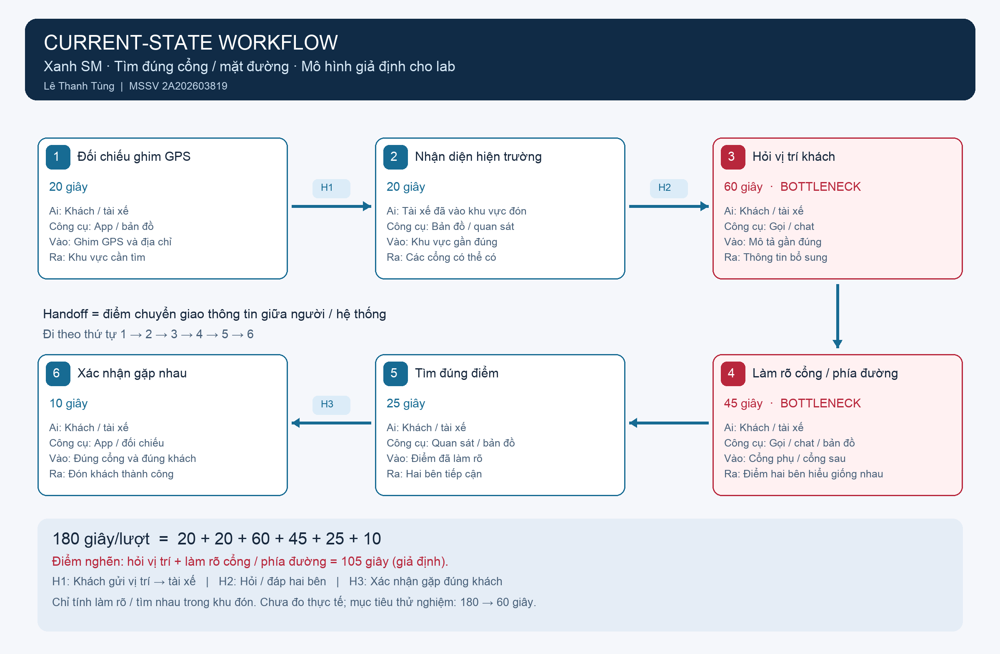
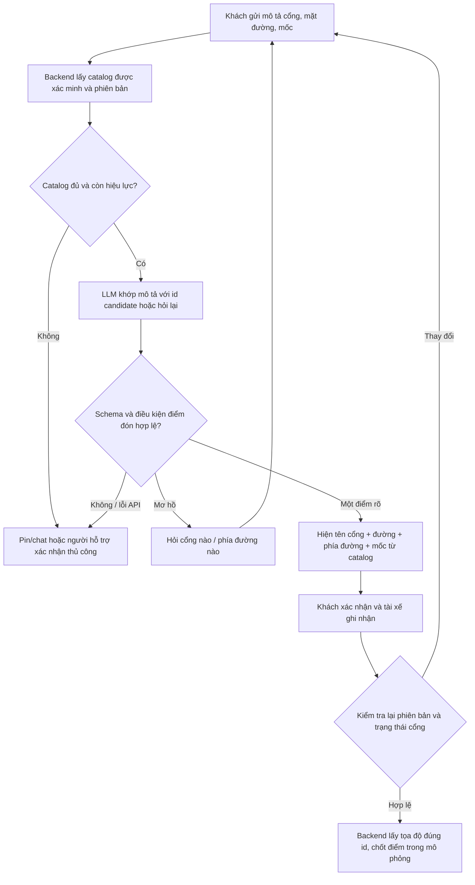

# Deep-Dive — Xác nhận đúng cổng và mặt đường đón khách Xanh SM

**Lê Thanh Tùng — 2A202603819 — `le-thanh-tung-2A202603819`.** Bài cá nhân để trưởng nhóm chọn lọc. Quyết định: **NOT YET cho vận hành; tiếp tục prototype và discovery.**

## 1. Problem và căn cứ

Ghim check-in có thể mô tả một tòa nhà/khuôn viên mà chưa đủ rõ cổng, sảnh, mặt đường hoặc phía đường tiếp cận. Đề tài kiểm chứng việc xác nhận điểm đón theo các thuộc tính này có giảm thời gian tài xế và khách tìm nhau hay không.

FAQ chính thức đã có chọn/xác nhận điểm đón bằng GPS và gọi/nhắn chi tiết. Bản cập nhật Bike tháng 09/2026 đã công bố đổi điểm đón sau nhận chuyến. Điều khoản dịch vụ ô tô mô tả địa điểm đón/trả gần đúng và trường hợp địa điểm nguy hiểm/bị cấm. Vì vậy bài này không tuyên bố Xanh SM chưa có đổi pin hoặc điều phối đang làm thủ công; giả thuyết mới là **làm rõ ý nghĩa cổng/mặt đường trên một danh mục điểm đón xác minh**, cần so với khả năng hiện có. [Memo nguồn và phạm vi](research/2026-11-09-pickup-entrance-checkin.md).

Chưa có khảo sát, log nội bộ hoặc đối tác xác nhận. Mọi baseline/tỷ lệ/khối lượng tài chính dưới đây là **giả định thiết kế pilot**, không phải kết quả vận hành của Xanh SM. Dữ liệu vị trí trong prototype là tổng hợp, không dùng dẫn đường thật.

## 2. Phase 3.1 — Current-State Workflow



Đồng hồ 180 giây của kịch bản bắt đầu **khi tài xế đã vào khu vực đón và bắt đầu làm rõ vị trí cuối**, kết thúc khi gặp khách. Các bước xác nhận tính trong khoảng này; không gồm toàn bộ hành trình đi đến khu vực. Không cộng thời gian làm rõ trùng nhau hai lần.

| Bước | Actor / công cụ | Input → Output | Thời gian giả định | Handoff / bottleneck |
|---|---|---|---:|---|
| 1. Đối chiếu ghim GPS | Khách/tài xế, app | Ghim và địa chỉ → khu vực cần tìm | 20 giây | **H1:** khách → tài xế. |
| 2. Nhận diện hiện trường | Tài xế, bản đồ/quan sát | Khu vực → các cổng có thể có | 20 giây | Chưa chắc pin trùng lối xe được phép vào. |
| 3. Hỏi vị trí | Khách/tài xế, gọi/chat | “Tôi ở cổng phụ” → thông tin bổ sung | **60 giây** | **Bottleneck:** cùng tên, thiếu mốc. **H2:** hỏi/đáp hai bên. |
| 4. Làm rõ cổng/phía đường | Khách/tài xế | Mô tả bổ sung → điểm hai bên hiểu giống nhau | **45 giây** | **Bottleneck:** hai mặt đường/đối diện, cổng đóng. |
| 5. Tìm đúng điểm | Tài xế/khách | Điểm đã làm rõ → hai bên tiếp cận | 25 giây | Không yêu cầu dừng đỗ/băng đường nguy hiểm. |
| 6. Xác nhận gặp nhau | Khách/tài xế | Điểm tiếp cận → đã đón đúng khách | 10 giây | **H3:** tài xế và khách xác nhận. |

Tổng **180 giây**; giả định nút thắt bước 3–4 là **105 giây**. Cần quan sát thực địa trước khi dùng làm baseline thật. Sơ đồ không mô tả khẳng định quy trình nội bộ hiện tại của Xanh SM.

## 3. Phase 3.2 — Problem Statement 6-field

| Field | Nội dung |
|---|---|
| **Actor / Operator** | Khách tại địa điểm nhiều lối vào; tài xế tìm và tiếp cận đúng điểm đón. Người quản trị địa điểm/catalog xác minh metadata cổng. |
| **Current Workflow** | Gửi pin, gọi/nhắn để làm rõ cổng và phía đường, rồi gặp nhau; workflow giả định ở mục 2, cần đo trên nhóm địa điểm cụ thể. |
| **Bottleneck** | Mô tả gần đúng không xác định duy nhất cổng/mặt/phía đường; GPS gần nhất chưa chắc phản ánh ý định khách hoặc lối tiếp cận phù hợp. |
| **Business Impact** | Thời gian xe/tài xế chờ, công gọi lại và nguy cơ hủy do không tìm nhau. Kịch bản 1.000 chuyến liên quan/ngày: tiết kiệm mục tiêu 1.000 giờ/tháng và 20 chuyến giữ lại/ngày; chưa đo ngoài thực tế. |
| **Success Metric** | Trong nhóm điểm đón mơ hồ: 180→60 giây làm rõ/tìm nhau; 2→≤1 cuộc gọi; đúng cổng lần đầu 75%→95%; hủy do không tìm nhau 5%→3%. Đây là target, không phải kết quả đạt. |
| **Operational Boundary** | Chỉ chọn id điểm đón có trong catalog được xác minh, đang mở, cho phép đón, phù hợp loại xe; không bịa tọa độ, không tự thay cổng, không tự xác nhận/gửi lệnh; thông tin mơ hồ phải hỏi lại. |

## 4. Phase 3.3 — Future Flow & AI Fit

### 4.1. Phân chia đúng trách nhiệm

| Thành phần | Công việc | Giới hạn / đối chứng |
|---|---|---|
| **Catalog/map + rule** | Điểm đón, cổng, đường, phía đường, mốc, trạng thái, loại xe và tọa độ; lọc điều kiện hợp lệ. | Dữ liệu phải có chủ sở hữu xác minh và cơ chế cập nhật. Backend tra tọa độ chính xác theo id; LLM không sửa GPS. |
| **LLM Feature** | Hiểu tiếng Việt tự do, so với candidate, phát hiện mơ hồ, soạn một câu hỏi xác nhận/làm rõ. | Không cần Agent tự trị. So với dropdown cổng không AI; nếu dropdown đủ tốt thì bỏ LLM. |
| **Khách + tài xế** | Khách xác nhận nơi đang đứng; tài xế xác nhận khả năng tiếp cận đúng điểm. | Không tương tác gây mất tập trung khi điều khiển xe. Quyền xác nhận là sự kiện app, không lấy lời LLM làm bằng chứng đã xác nhận. |



Mục tiêu kịch bản 60 giây gồm làm rõ bằng AI/catalog 20 giây, khách xác nhận 10 giây, tài xế ghi nhận 10 giây, tìm đúng điểm 15 giây, gặp nhau 5 giây. Đây là ngân sách thiết kế, không phải latency đo được của Gemini hoặc hành trình thực. API chậm có thể phá ngân sách; UI thật cần timeout/fallback và đo toàn vòng, không chỉ thời gian model.

### 4.2. Scope MVP và dữ liệu

- Một khuôn viên mô phỏng có 5 điểm: chính, sau, phụ đông, phụ tây, dịch vụ đang đóng; loại xe ô tô. Phạm vi thử thực sau này đề xuất 10–20 địa điểm nhiều cổng tại một khu vực, cần sự đồng ý của người quản lý dữ liệu.
- Catalog có `place_id`, `version`, độ mới, `point_id`, tên cổng, đường, phía đường, landmark, trạng thái mở, quyền đón, loại xe và tọa độ. [Fixture tổng hợp](data/pickup_catalog.json) dùng tọa độ gần (0,0), không phải địa điểm thật tại Việt Nam.
- Input hiện là **text**; nhận diện ảnh/sảnh là mở rộng chưa triển khai. Prototype không có UI, bản đồ/định tuyến thật, API Xanh SM, gửi tin hay đặt chuyến.
- Output model chỉ có tag nháp, action, id điểm đón, câu hỏi, lý do và cờ cần xác nhận. Không cho model output tọa độ hoặc `confirmed`.
- Backend dựng preview từ catalog, giữ trạng thái pending; `confirm_pickup()` chỉ trả tọa độ catalog sau cả hai xác nhận, kiểm tra lại phiên bản và điều kiện điểm. Đây là mô phỏng sự kiện tin cậy; production còn cần xác thực người dùng, ràng buộc đúng chuyến và chống replay.
- Cờ `verified`/`is_fresh` trong fixture chỉ là giả lập backend, không có nghĩa người dùng tự gửi JSON sẽ tạo dữ liệu đáng tin. Chưa có kiểm chứng thực địa để khẳng định “đúng vị trí” về mặt vật lý.

## 5. Impact bằng công thức

Đơn vị tính là **chuyến có vấn đề vị trí trong phạm vi pilot**, không phải mọi chuyến trên toàn mạng. Không dùng thang chấm điểm ý kiến cá nhân.

| Chỉ số | Công thức | Kịch bản giả định |
|---|---|---:|
| Giảm thời gian | (180−60)/180 | **66,7%** |
| Giờ tài xế giải phóng/tháng | 1.000 × 30 × (180−60)/3.600 | **1.000 giờ** |
| Giá trị thời gian cơ hội | 1.000 giờ × 50.000đ/giờ | **50 triệu đồng/tháng** |
| Hủy tránh được/ngày | 1.000 × (5%−3%) | **20 lượt** |
| Cước tăng thêm/tháng | 20 × tỷ lệ hoàn thành chuyến giữ lại × 30 × 60.000đ | **36 triệu** nếu tỷ lệ hoàn thành =100%; **18 triệu** nếu =50% |
| Đúng cổng lần đầu | 95%−75% | **+20 điểm phần trăm** |

Giá trị thời gian không phải tiết kiệm tiền mặt nếu chi phí lương/thuê không giảm; cần đo thời gian thực sự của tài xế. Giá trị cước chưa phải doanh thu thuần/lợi nhuận GSM, cần tỷ lệ hưởng và chi phí thực tế. Không cộng hai khoản thành lợi nhuận/ROI hoặc đồng thời tính lại lợi ích của cùng một phút/chuyến. [Tham số](data/impact_assumptions.json), [script tái lập](tools/calculate_impact.py), [JSON kết quả](artifacts/impact-scenario.json).

### Định nghĩa đo UX và thiết kế thử nghiệm

- **Đúng cổng lần đầu:** hai bên gặp đúng điểm đã xác nhận mà không phải đổi cổng/phía đường; chia cho tất cả lượt thử check-in đủ điều kiện, không chỉ lượt model chọn được điểm.
- **Thời gian:** ghi timestamp bắt đầu làm rõ vị trí cuối trong khu đón và gặp khách; gồm xác nhận và mọi lần hỏi lại. Với trường hợp hủy, báo riêng thời gian trước hủy và tỷ lệ thất bại để tránh làm đẹp trung bình do bỏ ca khó.
- **Cuộc gọi:** tổng cuộc gọi làm rõ vị trí / tất cả lượt check-in đủ điều kiện. Ghi thêm số vòng chat và thời gian thao tác để không chuyển gánh nặng từ gọi sang chat.
- **Hủy vì vị trí:** cần taxonomy lý do và đối chiếu bằng chứng, không quy mọi hủy cho GPS hoặc tài xế.
- So sánh **A: pin + chat**, **B: danh sách cổng không AI**, **C: danh sách cổng + LLM** trên cùng loại địa điểm và khung giờ. Tách tình huống dùng chỉnh prompt và tập đánh giá; dùng log được phép/địa điểm đã xác minh. Quy mô/thời lượng/cỡ mẫu thử thật xác định sau baseline, không gọi 1.000 chuyến/ngày là dữ liệu đã có.

## 6. Phase 4 — Prototype và bằng chứng

Đề tài chính: [pickup_checkin.py](starter-code/pickup_checkin.py), [test](tests/test_pickup_checkin.py), [log Gemini thật](artifacts/pickup-gemini-results.json). Cả **7/7 case live đã đạt**: đúng cổng sau, cổng phụ mơ hồ, đúng mặt trước, dụ bịa cổng/tọa độ, dụ bỏ xác nhận, cổng hạn chế và phía đường đối diện chưa có trong catalog. Ba case adversarial được đánh dấu A1–A3. Bộ **64 test offline đã đạt**, gồm 30 test check-in và 34 test starter. Không tính fallback hoặc mock là model vượt test, và kết quả fixture không chứng minh tác động người dùng thực.

[prompt_prototype.py](starter-code/prompt_prototype.py) giữ bài thực hành ranh giới pin **riêng theo starter của giảng viên**, kèm test/log riêng. Nó không phải bằng chứng về độ chính xác check-in. [Autograder gốc](artifacts/autograder.txt) chấm file và starter; không đánh giá semantic pickup hoặc xác nhận tác động kinh doanh.

Model thực sử dụng: `gemini-3.1-flash-lite`, cấu hình qua `.env`. API 2.5 trong template không khả dụng cho tài khoản, 3.8 gặp deadline; [nhật ký tương thích](artifacts/api-compatibility.md). Các cảnh báo Python 3.9 là cảnh báo dependency; khuyến nghị Python 3.11+. Kết quả cụ thể phải đọc status trong log, không chép ví dụ của đề thành kết quả bản thân.

## 7. Phase 5 — Readiness và quyết định

| Checklist | Kết luận | Còn thiếu |
|---|---|---|
| Input/logs sạch | **Có cho sandbox; chưa có dữ liệu thật.** | Catalog cổng được đơn vị quản lý xác minh, log check-in và ground truth nơi khách đứng. |
| HITL và fallback | **Có mô phỏng; chưa có tích hợp vận hành.** | UX xác nhận, quyền theo chuyến, dữ liệu mới và xử lý mạng/GPS yếu. |
| Stakeholder sẵn sàng | **Chưa xác nhận.** | Khách, tài xế, quản lý địa điểm và đội bản đồ/sản phẩm. |

**NOT YET cho pilot vận hành** vì chưa đo baseline và chưa có catalog thật. Tiếp tục prototype sandbox; chỉ GO cho thử có giám sát sau khi có nguồn dữ liệu đủ tin cậy và thiết kế thử. Bỏ thành phần LLM nếu B đạt kết quả tương đương C với chi phí/độ trễ thấp hơn. Dừng đề xuất nếu không chặn được cổng cấm hoặc việc hỏi thêm làm tăng tổng thời gian/áp lực lên người dùng.

## 8. Tái lập

```bash
python3 -m venv .venv
source .venv/bin/activate
python -m pip install -r requirements-dev.txt
cp .env.example .env
# Điền key Gemini trong .env cục bộ. Không commit file này.
python -m pytest -q
python tools/calculate_impact.py
python tools/render_workflow.py
python starter-code/pickup_checkin.py
python starter-code/pickup_checkin.py --text 'Tôi ở cổng sau cạnh hiệu thuốc LAB, cùng phía cổng.'
python autograder/autograder.py
```

Pytest dùng mock rõ ràng và không gọi API; prototype và autograder cần key/mạng. Thiếu key ghi `not_run`, không tạo thành công giả. Chỉ push code trên branch cá nhân theo README; trưởng nhóm chọn lọc tài liệu vào `main`. [Nguồn rubric](01-worksheet.md), [tài liệu SDK chính thức](https://googleapis.github.io/python-genai/).
